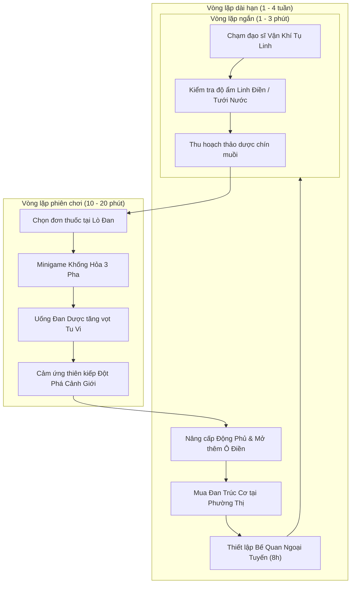
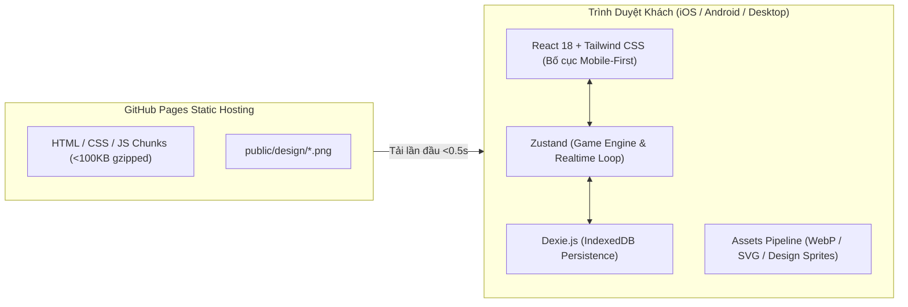

# PHÀM ĐẠO 2D (MOBILE-FIRST EDITION)
## Game Design Document (GDD) — Bản 2.0 / Sản Xuất Web & Di Động

**Thể loại:** Tu tiên 2D, mô phỏng đời sống, tu luyện nhàn rỗi (Idle/Simulation), trồng trọt thảo dược, luyện đan có chiều sâu, phường thị giao thương  
**Nền tảng mục tiêu:** Web Mobile-First (tối ưu màn hình dọc điện thoại, hỗ trợ PWA, tương thích trình duyệt máy tính, build tĩnh GitHub Pages)  
**Trải nghiệm cốt lõi:** Tu luyện chậm rãi · Luyện đan khống hỏa 3 pha · Chăm sóc linh điền · Xây dựng động phủ · Giao thương phường thị  
**Định hướng mỹ thuật:** Tiên hiệp thủy mặc cổ phong (Chinese Ink-Wash / Fantasy Wuxia), đồ họa 2D minh họa giàu chi tiết kết hợp hiệu ứng hào quang linh khí  
**Tình trạng tài liệu:** Đặc tả thiết kế 2D Mobile-First chính thức, đồng bộ hóa 100% với bộ mockup tại `assets/design/`

---

# 1. Tóm tắt điều hành (Executive Summary)

**Phàm Đạo 2D** đặt người chơi vào vai một phàm nhân từng bước dấn thân vào tu tiên giới, lấy phong cách chơi màn hình dọc (Mobile-First) làm trọng tâm. Người chơi trải nghiệm một hành trình tu đạo thanh tịnh, chân thực và có chiều sâu thông qua 5 phân hệ màn hình gắn kết mật thiết:

1. **🏯 Động Phủ:** Khuôn viên sơn trang riêng biệt gồm Đài Tu Luyện, Phòng Luyện Đan, Trận Tụ Linh, Kho Chứa, Hồ Linh Ngư và Vườn Linh Điền.
2. **🧘 Tu Luyện:** Đài tọa thiền bát quái tụ linh, vận chuyển công pháp, cảm ứng thiên kiếp đột phá cảnh giới và bế quan ngoại tuyến.
3. **🏺 Luyện Đan:** Lò đan rồng vàng tam muội chân hỏa, minigame điều phối hỏa hầu 3 pha (Tinh luyện ➜ Dung hợp ➜ Ngưng đan) quyết định phẩm chất đan dược.
4. **🌿 Linh Điền:** Vườn thảo dược sinh trưởng theo thời gian thực, quản lý độ ẩm, tưới tắm linh tuyền, bón linh thạch và thu hoạch thảo dược quý.
5. **🏮 Phường Thị:** Khu chợ tu chân sầm uất với các thương điếm (Linh Thảo Các, Đan Dược Các, Pháp Khí Đường, Công Pháp Phường) phục vụ giao thương và tìm kiếm cơ duyên.

---

# 2. Bốn Trụ Cột Trải Nghiệm (Core Pillars)

| Trụ Cột | Đặc Tả Thiết Kế | Điều Tuyệt Đối Tránh |
|---|---|---|
| **Chậm mà có tiến triển** | Mỗi phiên đăng nhập 3–5 phút đều có kết quả cụ thể (thu hoạch 1 luống thuốc, xuất lò 1 viên đan, đột phá 1 tầng). | Ép buộc treo máy liên tục hoặc tạo chuỗi nhiệm vụ điểm danh gây áp lực. |
| **Kinh tế vật chất tuần hoàn** | Vườn thuốc ➜ Dược liệu ➜ Luyện đan ➜ Đột phá/Tu vi ➜ Linh thạch ➜ Nâng cấp động phủ ➜ Vườn thuốc tốt hơn. | Bán vật phẩm P2W phá vỡ cân bằng tiến trình tu luyện tự nhiên. |
| **Thao tác một tay trực quan** | Toàn bộ giao diện thiết kế theo chuẩn màn hình dọc (Portrait), chạm vuốt mượt mà bằng ngón cái. | Nhồi nhét bảng biểu dày đặc văn bản, chữ quá nhỏ khó đọc trên điện thoại. |
| **Web tĩnh siêu nhẹ (Static-First)** | Chạy mượt mà trên GitHub Pages, bundle gọn nhẹ (<150KB), mở tức thì trên mạng 4G/5G, không nóng máy. | Sử dụng các thư viện 3D cồng kềnh gây giật lag và hao pin thiết bị di động. |

---

# 3. Vòng Lặp Trò Chơi (Core Loops)

---

# 4. Đặc Tả Chi Tiết 5 Phân Hệ Màn Hình (Theo Mockup `assets/design/`)

## 4.1. Thanh Trạng Thái Đỉnh (Top Header Bar)
Hiển thị xuyên suốt ở cạnh trên của tất cả các màn hình:
- **Thông tin nhân vật (Góc trái):**
  - Khung Avatar chibi đạo sĩ tròn, viền kim sắc kèm huy hiệu đẳng cấp `Lv.12`.
  - Đạo hiệu người chơi: `Tạ Văn Nam`.
  - Cảnh giới hiện tại: `Luyện Khí tầng 2` kèm biểu tượng hoa sen và thanh tu vi mini màu lam.
- **Hệ thống tiền tệ & tài nguyên (Góc phải):**
  - 🟢 **Ngọc Biếc (Jade Tokens):** Tiền tệ trân quý, dùng mua bí kíp và đan phương hiếm (Mẫu: `1.280 +`).
  - 🪙 **Linh Thạch / Bạc (Spirit Stones):** Tiền tệ giao dịch phổ thông dùng nâng cấp và giao thương (Mẫu: `56.420 +`).
  - 🟡 **Kim Nguyên Bảo (Gold Ingots):** Thỏi vàng nguyên chất dùng trong đấu giá và sự kiện đặc biệt (Mẫu: `320 +`).
  - ⚡ **Thể Lực (Stamina):** Giới hạn hành động khám phá/vận khí trong ngày (Mẫu: `120/120 +`).
- **Thanh thao tác phụ:** Biểu tượng `Thư` (kèm chấm đỏ), `Thông báo` và `Cài đặt`.

---

## 4.2. Màn Hình 1: Tu Luyện (`tu-luyen.png`)
Trọng tâm tu tập nội công, bồi đắp kinh mạch và đột phá bình cảnh:
- **Khung cảnh trung tâm:**
  - Đạo sĩ tĩnh tọa kiết già giữa động thiên phúc địa, trên bệ đá Bát Quái tỏa hào quang sen vàng.
  - Phù chú kim sắc bay lượn (`符`), lư hương tỏa khói trầm nghi ngút, hậu cảnh có thác nước và rặng trúc.
  - **Tương tác chạm (Clicker Feedback):** Người chơi chạm vào nhân vật hoặc đài sen để chủ động vận chuyển chu thiên, bùng nổ hiệu ứng ánh sáng kèm chữ bay `+120 Tu Vi`.
- **Thẻ Công Pháp Đang Tu Luyện:**
  - Hiển thị công pháp chủ tu: `Trường Xuân Công` (Phẩm cấp: Phàm cấp • Thuộc tính: Hồi phục • Bền bỉ).
  - Nút `Đổi công pháp >` cho phép chuyển đổi giữa các bộ bí tịch thu thập được.
- **Thanh Tiến Độ Tu Vi & Đột Phá:**
  - Thanh đo tu vi hiện tại: `7.200 / 12.000` (đạt 60% tiến trình tầng hiện tại).
  - Hàng hiển thị mốc đột phá: `[Luyện Khí tầng 2]` ➜➜ `[Luyện Khí tầng 3]`.
  - Khi thanh tu vi đạt 100%, nút bấm chuyển sang trạng thái kích hoạt phát sáng mời gọi người chơi cảm ứng thiên kiếp.
- **Ba Khối Hành Động Cốt Lõi:**
  - 🏯 **Bế quan:** Chế độ tu luyện liên tục thụ động, tích lũy tu vi tự động ngay cả khi thoát game.
  - 🌀 **Vận khí:** Tiêu hao thể lực để vận chuyển linh lực đại chu thiên, nhận lượng lớn tu vi tức thì.
  - 📜 **Tham ngộ:** Lĩnh ngộ đạo lý từ ngọc giản, gia tăng độ thuần thục công pháp và mở khóa hiệu ứng ẩn.
- **Khung Dự Tính Thu Hoạch Bế Quan 8 Giờ:**
  - Hiển thị số liệu ước tính khi người chơi ngoại tuyến: `Tu vi: +4.800` • `Linh khí: +240` • `Dược liệu: 2 ~ 4`.

---

## 4.3. Màn Hình 2: Động Phủ (`dong-phu.png`)
Không gian gia viên riêng biệt, quản lý toàn diện các kiến trúc công năng:
- **Danh sách nhiệm vụ & sự kiện (Góc trên bên trái):**
  - `[Chính] Củng cố tu vi:` Tu luyện đến Luyện Khí tầng 3 (tiến độ 2/3).
  - `[Ngày] Chăm linh điền:` Thu hoạch linh thảo 4 lần (tiến độ 0/4).
  - Khung banner: `Sự kiện Tiệc Nguyệt Hoa` (thời gian đếm ngược).
- **Hệ thống công trình tương tác trên bản đồ:**
  - **Đài Tu Luyện:** Lầu gác trên cao có tượng Phật phát quang, chạm vào để chuyển nhanh sang màn hình *Tu Luyện*.
  - **Phòng Luyện Đan:** Gian nhà đan phòng với lò đan đồng đỏ, chạm vào để mở giao diện *Luyện Đan*.
  - **Linh Điền:** Khu vườn 4 luống hoa thảo dược đang nở rộ, chạm vào để sang tab *Linh Điền*.
  - **Trận Tụ Linh:** Thạch đài có tinh thể phát sáng và linh phù xoay quanh suối nước, tăng tốc độ hấp thu linh khí toàn động phủ.
  - **Kho Chứa:** Nhà kho tranh chứa bảo quản dược liệu, khoáng thạch và đan dược tích trữ.
  - **Hồ Linh Ngư:** Cầu gỗ bắc qua hồ sen có guồng nước và đàn cá chép Koi bơi lội, giúp tĩnh dưỡng tâm cảnh.

---

## 4.4. Màn Hình 3: Linh Điền (`linh-dien.png`)
Nông trại thảo dược phục vụ nguồn nguyên liệu cho đan đạo:
- **Khuôn viên 8 Ô Điền (2x4 ô đất):**
  - Đất màu mỡ bao quanh bởi hàng rào trúc và giếng nước đá rêu phong.
  - Mỗi ô đất hiển thị trực quan các loài thảo dược ở các giai đoạn: mầm non, cây xanh, bụi đơm hoa tím, quả đỏ và rễ sâm vàng phát quang.
  - Nhân vật chibi cầm bình tưới vàng đứng giữa vườn chăm sóc.
- **Bảng Chi Tiết Thảo Dược Đang Chọn (Khung dưới):**
  - Hình ảnh minh họa: `Mộc Linh Hoa (Linh thảo bậc 2)`.
  - Trạng thái sinh trưởng: `Giai đoạn: Sinh trưởng (70%)` kèm thanh tiến độ xanh lá.
  - Đếm ngược: `Thời gian còn: 00:18:26`.
  - Độ ẩm đất: `Độ ẩm: 72% (Tốt)` (ảnh hưởng trực tiếp đến phẩm chất khi thu hái).
  - Dự kiến sản lượng: `🌸 x6 ~ 9`.
- **Ba Nút Thao Tác Nhanh:**
  - 💧 **Tưới:** Bơm nước linh tuyền duy trì độ ẩm lý tưởng (nút xanh lam).
  - 🔮 **Bón linh thạch:** Tiêu hao linh thạch vụn để kích thích linh khí, giảm ngay thời gian sinh trưởng (nút tím).
  - 🧺 **Thu hoạch:** Thu hái linh thảo vào kho khi đạt 100% độ chín (nút xám/xanh lá khi sẵn sàng).

---

## 4.5. Màn Hình 4: Luyện Đan (`luyen-dan.png`)
Nghề nghiệp trọng tâm tạo ra bước ngoặt đột phá cảnh giới:
- **Bảng Chọn Đơn Thuốc (Cột trái):**
  - `Tụ Khí Đan` (Đang chọn - hỗ trợ đột phá Luyện Khí ➜ Trúc Cơ).
  - `Tráng Thể Đan` (Tăng cường khí huyết và thể lực).
  - `Thanh Tâm Đan` (Tịnh tâm ngưng thần, ổn định kinh mạch).
  - `Hồi Nguyện Đan` (Phục hồi linh lực tức thì).
  - `Bế Cốc Đan` (Tăng mạnh hiệu quả bế quan ngoại tuyến).
- **Lò Đan Thần Nông (Trung tâm):**
  - Đỉnh đồng ba chân chạm khắc song long chầu nguyệt, chính giữa có đồ hình Bát Quái âm dương.
  - Ngọn lửa bập bùng dưới đáy đỉnh biểu thị hỏa hầu đang vận hành.
- **Khung Nguyên Liệu Cần Có (Kiểm tra điều kiện):**
  - Nhân Sâm Linh: `12 / 3` ✔️
  - Tụ Linh Thảo: `28 / 5` ✔️
  - Linh Thạch: `36 / 4` ✔️
  - Linh Chi: `17 / 2` ✔️
  - Tỉ lệ thành công cơ bản: `85%`.
- **Tiến Trình Điều Phối 3 Pha (3-Phase Progress):**
  - `Tinh luyện` ➜➜ `Dung hợp` ➜➜ `Ngưng đan` (hiện vầng lửa sáng rực).
- **Thước Đo Cường Độ Lửa (Fire Intensity Slider):**
  - Nút `[-]` và `[+]` căn chỉnh mức nhiệt từ `Lv.1` đến `Lv.10` (mức tối ưu hiển thị tại `Lv.7 / 10`).
- **Dự Báo Tỉ Lệ Phẩm Chất Đầu Ra:**
  - Hạ phẩm (5%) • Trung phẩm (25%) • Thượng phẩm (55%) • Cực phẩm (15%).
- **Thanh Thao Tác Đáy:**
  - Ô tích chọn `[✔] Liên tục luyện (tối đa 10 lần)`.
  - Nút chính nổi bật: `[ Bắt đầu luyện đan ]` viền vàng kim cương rực rỡ.
  - Bộ đếm số lượng mẻ luyện: `Số lần: [-] 1 [+]`.

---

## 4.6. Màn Hình 5: Phường Thị (`phuong-thi.png`)
Khu giao thương buôn bán sầm uất giữa lòng tu tiên giới:
- **Cảnh quan chợ phiên:**
  - Cổng chào gỗ chạm khắc bảng hiệu mạ vàng `Phường Thị`.
  - Các gian hàng truyền thống treo cờ hiệu: `Linh Thảo Các`, `Đan Dược Các`, `Pháp Khí Đường`, `Công Pháp Phường`.
  - Các NPC thương nhân và tu sĩ qua lại trò chuyện tạo không khí sống động.
- **Danh Mục Giao Dịch (Khung dưới bên trái - 4 thẻ icon):**
  - 💊 **Đan dược:** Mua bán các loại tiên đan hỗ trợ tu luyện.
  - 🌿 **Linh thảo:** Trao đổi hạt giống quý và dược liệu thu hoạch.
  - 🗡️ **Pháp khí:** Trang bị bảo giáp và phi kiếm tăng cường thực lực.
  - 📖 **Công pháp:** Điển tịch, ngọc giản bí truyền các hệ ngũ hành.
- **Gian Hàng Vật Phẩm Đề Cử (Góc phải):**
  - Vật phẩm tiêu điểm: **Đan Trúc Cơ** (Bảo đan hỗ trợ đột phá đại cảnh giới Luyện Khí ➜ Trúc Cơ).
  - Ưu đãi giảm giá: `Hôm nay -20%`.
  - Giá bán: `48.000` Linh thạch (Giá gốc: `60.000`).
  - Nút mua vàng kim: `[ Mua ]`.

---

# 5. Hệ Thống Dữ Liệu & Thuật Toán Cốt Lõi

## 5.1. Thuật toán tiến độ tu vi và bế quan
- **Yêu cầu tu vi ở tầng $n$:**
  $$T(n) = 100 \times 1.8^{(n - 1)}$$
  *(Tầng 1: 100, Tầng 2: 180, Tầng 3: 324, ..., Luyện Khí tầng 2 lên tầng 3: 12.000 tu vi ở bản mở rộng).*
- **Tu vi nhận được khi Vận Khí chủ động (Tap Action):**
  $$G_{tap} = 120 \times E_{affinity} \times E_{technique}$$
- **Tu vi Bế Quan ngoại tuyến (Lazy Settlement):**
  $$G_{offline} = 600 \times \min(H_{offline}, 8) \times E_{abode}$$
  *(Với $H_{offline}$ là số giờ người chơi đóng trình duyệt; trần giới hạn tối đa 8 giờ mỗi ngày để chống lạm phát).*

## 5.2. Thuật toán phẩm chất luyện đan 3 pha
Điểm phẩm chất tổng hợp $S$ (thang điểm 0–100):
$$S = \text{clamp}\left(0, 100, 35 + 0.25P + 0.25H + 0.15M - 0.20D + \text{jitter}\right)$$
Trong đó:
- $P$: Độ tinh khiết và độ tươi dược liệu (0–100).
- $H$: Điểm khống chế hỏa hầu khớp với mức nhiệt tối ưu (0–100).
- $M$: Cảnh giới và kinh nghiệm đan đạo của tu sĩ.
- $D$: Độ sai lệch thời điểm ngưng đan.
- $\text{jitter}$: Sai số ngẫu nhiên thiên địa ($\pm 3$).

| Thang Điểm $S$ | Phẩm Chất | Hiệu Quả Dược Lực |
|---|---|---|
| $< 35$ | Hỏng mẻ | Tro dược (bón cây), nhận ít kinh nghiệm đan đạo |
| $35 - 54$ | Hạ phẩm | Đạt 100% hiệu quả cơ bản |
| $55 - 74$ | Trung phẩm | +15% hiệu lực tu vi / hồi khí |
| $75 - 89$ | Thượng phẩm | +30% hiệu lực, tăng xác suất đột phá |
| $\ge 90$ | Cực phẩm | +50% hiệu lực, kích hoạt dị tượng thiên địa |

---

# 6. Kiến Trúc Kỹ Thuật Web Tĩnh (Static Web Architecture)

1. **Hosting:** Thuần Static Web trên **GitHub Pages** thông qua GitHub Actions tự động build mỗi khi push code vào nhánh `main`.
2. **Lưu trữ dữ liệu:** Toàn bộ tiến trình tu luyện, số lượng thảo dược, đan hoàn và công trình được ghi vào **IndexedDB (Dexie.js)** cục bộ của trình duyệt.
3. **Cơ chế sao lưu an toàn:** Hỗ trợ tính năng Xuất (Export) và Nhập (Import) file bản lưu `.json` để người chơi chuyển đổi thiết bị thoải mái mà không sợ mất dữ liệu.
4. **Bundle size tối ưu:** Toàn bộ mã nguồn đóng gói nén gzip chỉ đạt **~88 KB**, khởi động tức thời, đáp ứng tiêu chuẩn PWA (Progressive Web App).

---

# 7. Lộ Trình Phát Triển & Tiêu Chí Nghiệm Thu

## 7.1. Các cột mốc thực hiện
- [x] **Mốc 1 (Foundations):** Thiết lập dự án Vite, React, TypeScript, TailwindCSS, pipeline CI/CD GitHub Pages.
- [x] **Mốc 2 (Core Game Engine):** Hệ thống Tu vi, Kinh mạch, Bế quan ngoại tuyến (Lazy settlement), Luyện đan 3 pha, Vườn linh điền.
- [x] **Mốc 3 (Mobile-First Pivot):** Chuyển đổi toàn diện sang giao diện màn hình dọc chuẩn di động.
- [x] **Mốc 4 (Asset Integration):** Tích hợp hoàn chỉnh 5 giao diện minh họa từ `assets/design/` (`dong-phu.png`, `tu-luyen.png`, `luyen-dan.png`, `linh-dien.png`, `phuong-thi.png`).
- [ ] **Mốc 5 (Audio & Polish):** Bổ sung nhạc nền cổ phong thiền định (tiếng đàn tranh, sáo trúc, suối chảy) và âm thanh click xúc giác.

## 7.2. Định nghĩa hoàn thành (Definition of Done - DoD)
Người chơi truy cập vào đường link GitHub Pages trên điện thoại thông minh có thể:
1. Chiêm ngưỡng toàn bộ 5 màn hình đẹp như tranh vẽ, không bị lỗi bố cục.
2. Chạm vào đài sen để vận khí, nhận phản hồi trực quan và tích lũy tu vi.
3. Bấm tưới nước, bón linh thạch và thu hoạch thảo dược tại Linh Điền.
4. Căn chỉnh cường độ lửa và luyện thành công viên đan dược tại Đan Phòng.
5. Ghé thăm Phường Thị đổi đan dược lấy linh thạch hoặc sắm sửa vật phẩm quý.
6. Tắt trình duyệt, hôm sau quay lại mở trang web vẫn giữ nguyên vẹn tiến trình và nhận đầy đủ tu vi bế quan 8 giờ.

